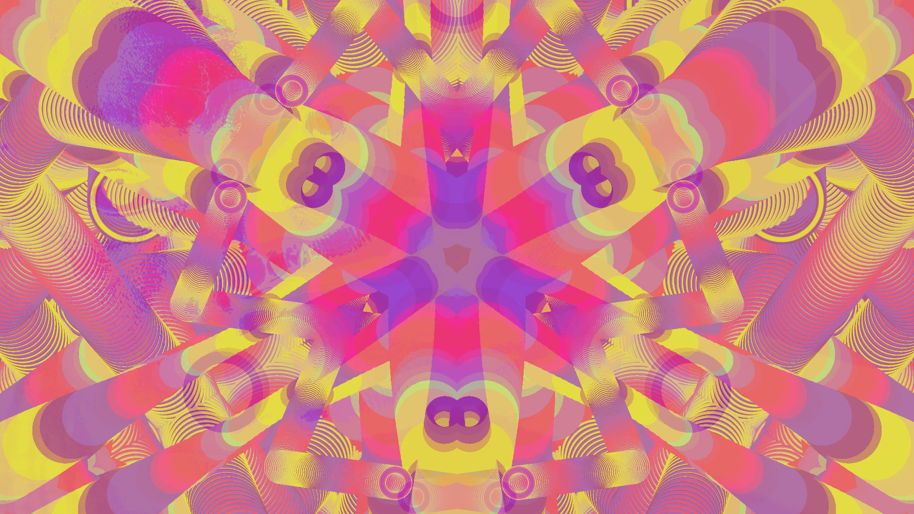

# neopsych

A palette-cycling psychedelic screensaver in the spirit of Synthesoft's
*Psychedelic Screen Saver*, rebuilt for modern graphics cards so it stays
smooth and cheap even at 4K. Every pixel stores a position in a 256-colour
palette; the palette rotates and morphs, shapes paint their trails into the
picture, and backgrounds (patterns or your own pictures) fade in now and then.
There are 120 presets: 24 families in 5 variations each.



## Running it

| How | What happens |
|---|---|
| Start menu → **neopsych** | with hotkeys, fullscreen or in a window as you last left it (`neopsych.exe --play`) |
| `neopsych.exe --fullscreen` / `--window` | with hotkeys, fullscreen / in a window |
| `neopsych.exe /s` | as the screensaver: every monitor, any key or mouse movement ends it |
| `neopsych.exe /c` or no arguments | opens the settings file in Notepad |
| `neopsych.exe /p <hwnd>` | the small preview in Windows' screensaver settings |

Hotkeys, mouse controls and on-screen messages work only when you start it
yourself (the first two rows); as a screensaver it stays clean and exits on
any input.

## Keyboard

Press **H** in neopsych for this list. Everything marked *saved* is written to
the settings file the moment you change it and stays that way next time.

### Presets

| Key | What it does |
|---|---|
| **← / →** | previous / next preset |
| **PgUp / PgDn** | jump a family (5 presets) back / forward |

### Background and pictures

| Key | What it does |
|---|---|
| **B** | fade in a new **b**ackground pattern |
| **L** | **l**ock the background: it no longer changes by itself, only the shapes do and their trails build up (*saved*) |
| **P** | **p**ictures on / off; off fades a showing picture over to a pattern (*saved*) |
| **N** | **n**ext picture, now |
| **S** | pictures from **s**ubfolders of the picture folder too, on / off (*saved*) |

### Shapes

| Key | What it does |
|---|---|
| **O** | moving shapes (**o**bjects) on / off; off also fades in a clean background (*saved*) |
| **M** | **m**irror symmetry: steps from random (each preset picks its own) through none, left/right, half turn, 2–6 mirrors… and back to random (*saved*) |
| **G** | **g**lyph rain on / off: a shower starts now and more follow, or none at all (*saved*) |
| **↑ / ↓** | movement faster / slower (*saved*) |

### Colours

| Key | What it does |
|---|---|
| **C** | blend into new **c**olours |
| **R** | **r**everse the colour cycling |
| **+ / −** | colour cycling faster / slower (*saved*) |

### View

| Key | What it does |
|---|---|
| **Space** | pause / resume |
| **F** or **F11** | fullscreen on / off (*saved*: the Start menu opens it the same way) |
| **I** | on-screen **i**nfo on / off (*saved*) |
| **H** | **h**elp: list the hotkeys |
| **Esc** | quit |

Holding the arrow keys or **+ −** repeats them; the other keys act once per press.

## Mouse

| Mouse | What it does |
|---|---|
| **Click** | random preset (half a second after the click, so a double-click doesn't count) |
| **Double-click** | fullscreen on / off (*saved*) |
| **Wheel** | movement faster / slower (*saved*) |
| **Right button held + wheel**, or **Shift + wheel** | colour cycling faster / slower (*saved*) |

## On-screen messages

Each hotkey confirms what it did in the top-left corner ("Pictures: off",
"Symmetry: 4 mirrors", "Colour speed: 1.25"…), and each new preset shows its
name. Messages fade after two seconds; **I** switches them off.

## Settings

The settings file is `%APPDATA%\neopsych\neopsych.ini`; start neopsych with
`/c` to open it. Delete it to get the defaults back.

| Setting | Default | Meaning |
|---|---|---|
| `pixel_scale` | 1 | 1 = full resolution; 2 or 4 = chunkier retro pixels and less GPU work |
| `fps` | 60 | frame rate cap |
| `smooth` | true | smooth gradients; false = hard 256-colour steps like the original |
| `speed` | 1.0 | colour cycling speed (**+ / −**) |
| `motion` | 1.0 | shape movement speed (**↑ / ↓**) |
| `preset_seconds` | 60 | seconds per preset |
| `transition_seconds` | 45 | average seconds between new backgrounds, independent of preset changes |
| `preset` | 0 | 0 = all presets in random order; 1–120 = stay on one |
| `image_folder` | *(empty)* | folder of pictures; empty = your Pictures folder |
| `image_subfolders` | false | also use pictures in its subfolders (**S**) |
| `image_chance` | 0.9 | chance a new background is a picture; 0 = never |
| `pictures` | true | pictures on (**P**) |
| `objects` | true | moving shapes on (**O**) |
| `hold_background` | false | keep the background (**L**) |
| `messages` | true | on-screen messages (**I**) |
| `rain` | true | glyph rain showers (**G**) |
| `symmetry` | random | `random`, or one kept for every preset: `1` none, `1m` left/right mirror, `2` half turn, `3` 3-fold turn, `2m`–`6m` 2–6 mirrors (**M**) |
| `fullscreen` | true | how `--play` and the Start menu open it (**F**) |

To try settings without touching yours, point `NEOPSYCH_CONFIG` at another file.

## Recording

Windows' Game Bar records neopsych together with whatever music is playing:
**Win + Alt + R** starts and stops; videos go to `Videos\Captures`. Set
*Settings → Gaming → Captures → Captured audio* to all sound, since neopsych
itself is silent.

## Video effects for mpv

The `mpv` folder brings the same colour cycling to videos played in
[mpv](https://mpv.io). Copy its contents into `%APPDATA%\mpv`.

| Key | What it does |
|---|---|
| **p** | colour effect on / off |
| **Shift+P** | colour speed: steps through 0.4, 1.0, 0.04, 0.12 |
| **Ctrl+P** | effect strength: steps through 0.5, 0.25, 1 |
| **k** | kaleidoscope on / off; fills the screen even for square videos |
| **Shift+K** | kaleidoscope wedges: steps through 2, 4, 6, 3 |
| **b** | motion blur on / off |
| **n** | random mode on / off: every 10 to 40 s jump to a random other video in the same folder, somewhere in its middle |
| **Shift+N** | jump to a random other video now |
| **↑ / ↓** | playback faster / slower; below normal speed frames blend smoothly |
| **Shift+↑ / ↓** | jump a minute forward / back |

Each key shows what it switched to. All other keys are mpv's usual ones
(Space pause, Enter next file, ← → seek, f fullscreen, q quit).
Mute and volume, the effects and their settings are kept as you last left
them (in `%APPDATA%\mpv\effects.txt` and `volume.txt`).

## Building

Needs Rust with the GNU toolchain and MinGW (for `windres`, which builds the
icon into the exe):

```
cargo build --release
```

`cargo run --example make_icon` redraws `assets/neopsych.ico`.
